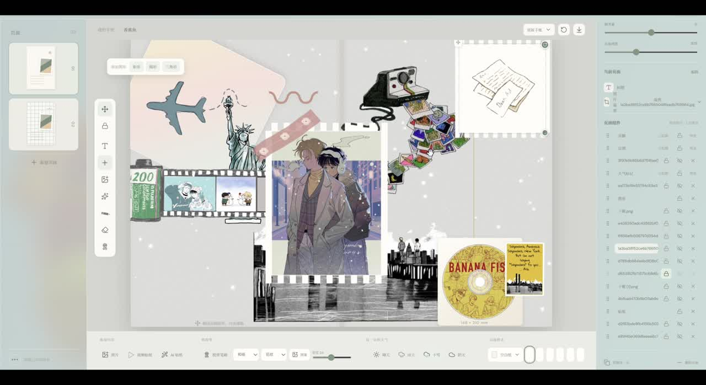

# Yejian · Digital Journal

## Demo Video

[](https://jessica20357.github.io/digital-journal/demo/)

Click the cover above to watch the full **banana fish** demo. It showcases photo collages, background removal, sticker effects, washi tape decoration, text layouts, and the journal reading experience.

The video runs for approximately **2 minutes and 26 seconds**. The web version preserves the full content and original audio, uses H.264 / AAC MP4, and is scaled to 1920 pixels wide for online playback.

- [Open the video player](https://jessica20357.github.io/digital-journal/demo/)
- [Play the MP4 directly](https://jessica20357.github.io/digital-journal/demo/journal-demo.mp4)
- [View the video file in this repository](public/demo/journal-demo.mp4)

## Features

| Feature                | Description                                                                                                      |
| ---------------------- | ---------------------------------------------------------------------------------------------------------------- |
| Digital bookshelf      | Create, open, and delete journals; customize covers and ribbons; browse multiple journals in a scrolling gallery |
| Freeform canvas        | Two-page spreads with a spine, separate page colors, paper templates, and custom page dimensions                 |
| Text layouts           | Add multiple text boxes and adjust fonts, sizes, colors, bold, italic, and horizontal or vertical writing        |
| Images and stickers    | Import independent images, crop them, remove backgrounds, add outlines, and apply sticker styles                 |
| Component controls     | Move, rotate, resize, lock, copy and paste, and reorder components in the layer panel                            |
| Drawing and washi tape | Draw continuously, adjust pen color and width, and erase parts of drawings or tape with an adjustable eraser     |
| Page weather           | Sunny, rainy, snowy, and cloudy effects with adjustable intensity or cloud density                               |
| Page music             | Assign a different soundtrack to each page; use one sound control for music, page-turn sounds, and chimes        |
| Local storage          | Automatic and manual saving, undo, and redo                                                                      |
| Reading mode           | Hide editing tools and browse your journal                                                                       |

Images and decorative elements resize freely by default. Hold **Shift** while resizing to preserve their proportions.

## Quick Start

Requires **Node.js 22.12 or later** and npm.

```bash
git clone https://github.com/jessica20357/digital-journal.git
cd digital-journal
npm ci
npm run dev
```

Open the local URL shown in your terminal, usually `http://127.0.0.1:5173/`.

| Command                 | Purpose                                        |
| ----------------------- | ---------------------------------------------- |
| `npm run dev`           | Start the local development server             |
| `npm run typecheck`     | Check TypeScript types                         |
| `npm run format`        | Format source code and documentation           |
| `npm run format:check`  | Check source code and documentation formatting |
| `npm run build`         | Build a static site served from the root path  |
| `npm run build:pages`   | Build for GitHub Pages at `/digital-journal/`  |
| `npm run preview:pages` | Preview the GitHub Pages build locally         |
| `npm run preview`       | Preview a root-path build locally              |

## Code Structure

```text
digital-journal/
├── .github/workflows/deploy.yml   # Automated build and deployment
├── docs/architecture.md          # Module responsibilities and data flow
├── public/
│   ├── audio/page-flip.mp3        # Page-turn sound
│   ├── demo/                     # Video player, demo video, and poster
│   └── journal-icon.svg          # Site icon
├── src/
│   ├── app/                      # App startup and bookshelf/editor coordination
│   ├── assets/                   # Default scenery artwork
│   ├── config/                   # Default pages, colors, and paper presets
│   ├── domain/                   # Journal and page component types
│   ├── features/
│   │   ├── audio/                # Sound controls
│   │   ├── books/                # Book animations and interactive chimes
│   │   ├── canvas/               # Drawing, erasing, tape, and component locking
│   │   ├── images/               # Cropping, background removal, and sticker effects
│   │   ├── text/                 # Rich text and font size controls
│   │   └── weather/              # Weather effects
│   ├── storage/                  # IndexedDB storage and legacy data migration
│   ├── styles/                   # Interface, animation, and editor styles
│   └── main.tsx                  # React entry point
├── index.html
├── package.json
├── package-lock.json
├── tsconfig.json
└── vite.config.ts
```

Built with **React, TypeScript, Vite, Three.js, Canvas / WebGL, and IndexedDB**. See the [architecture guide](docs/architecture.md) for module responsibilities and the saving workflow.
